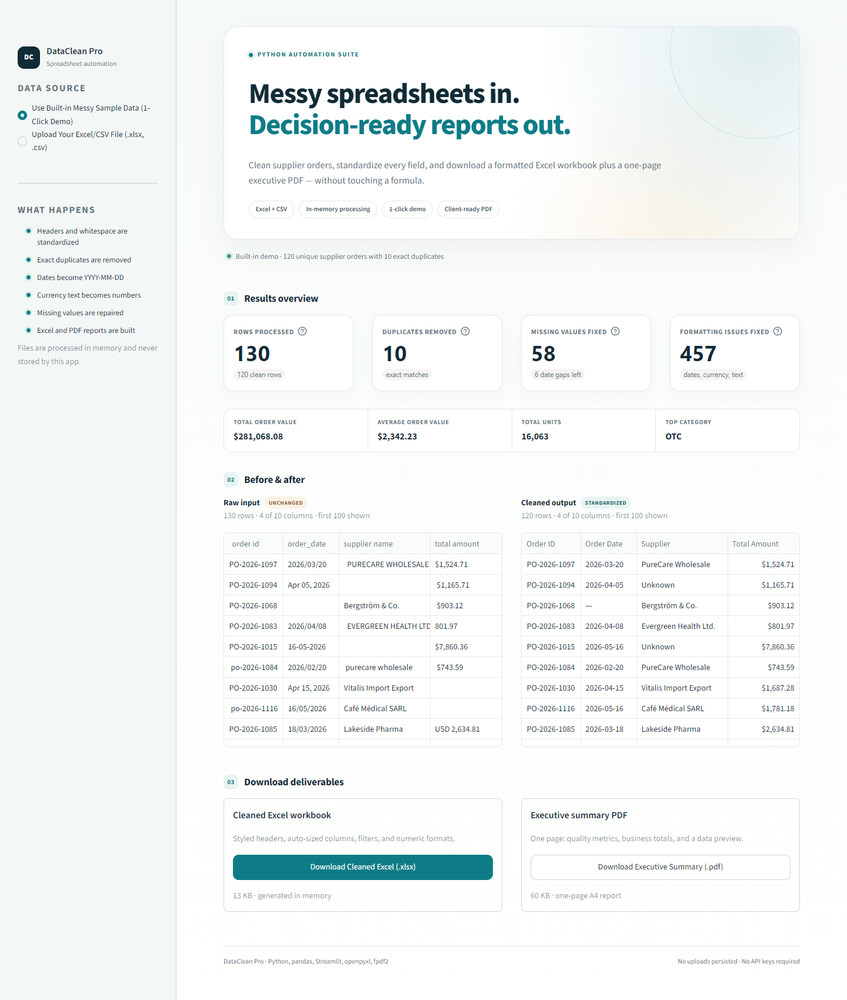

# DataClean Pro

A portfolio-ready Python web app that turns messy supplier spreadsheets into a clean, styled Excel workbook and a one-page executive PDF — in a single click.

Built for operations, finance, and supply-chain teams that still receive orders, invoices, or inventory lists with mixed date formats, currency symbols, duplicate rows, inconsistent casing, stray whitespace, and missing cells.

## Preview



## Highlights

- **One-click demo** with a realistic, deliberately messy pharmacy supplier dataset
- **Upload your own** `.xlsx` or `.csv` file (first Excel sheet is used)
- **Before/after metrics** for rows processed, duplicates removed, missing values repaired, and formatting fixes
- **Side-by-side previews** of the raw and cleaned data
- **Styled Excel download** with branded headers, filters, frozen panes, numeric formats, and auto-sized columns
- **One-page PDF summary** with data-quality KPIs, business totals, and a formatted preview table
- **Unicode-safe PDF output** using system fonts with a graceful core-font fallback
- **No API keys, no local paths, no persistence** — all processing happens in memory

## Project structure

```text
python-automation-suite/
├── .streamlit/
│   └── config.toml       # Light theme + minimal demo toolbar
├── app.py                # Streamlit UI and download wiring
├── cleaner.py            # Cleaning pipeline + styled Excel export
├── sample_data.py        # Deterministic messy sample dataset
├── report_generator.py   # One-page fpdf2 executive summary
├── assets/
│   └── demo.png          # README preview
├── requirements.txt
├── tests/
│   └── test_pipeline.py  # End-to-end verification
├── .gitignore
└── README.md
```

### Data flow

```text
Messy CSV / XLSX / sample
        │
        ▼
  cleaner.clean_dataframe()
  ├─ standardize headers
  ├─ trim whitespace
  ├─ remove exact duplicates
  ├─ parse dates -> YYYY-MM-DD
  ├─ parse currency -> float
  ├─ repair missing values
  └─ return cleaned DataFrame + stats
        │
        ├──► openpyxl styled .xlsx
        └──► fpdf2 one-page .pdf
```

## Quickstart

Requires **Python 3.11+**.

```bash
git clone <your-repository-url>
cd python-automation-suite

python -m venv .venv
# Windows
.venv\Scripts\activate
# macOS / Linux
source .venv/bin/activate

pip install -r requirements.txt
streamlit run app.py
```

Open the local URL Streamlit prints (usually `http://localhost:8501`). Choose the built-in demo and download both files immediately.

## How to use it

1. Pick **Use Built-in Messy Sample Data (1-Click Demo)** in the sidebar, or upload an `.xlsx`/`.csv` file.
2. Review the before/after metrics and side-by-side previews.
3. Download **Cleaned Excel (.xlsx)** and the **Executive Summary (.pdf)**.

Uploaded files are read in memory. The app does not write them to disk, store them in a database, or call an external API.

## Cleaning rules

| Area | Behavior |
| --- | --- |
| Headers | Trimmed, readable names; aliases such as `qty`, `order_date`, and `unit price ($)` map to canonical names |
| Whitespace | Leading, trailing, and repeated internal whitespace removed |
| Duplicates | Exact duplicate rows removed after whitespace normalization |
| Dates | `2026/03/15`, `15-03-2026`, `Mar 15, 2026`, and Excel date values normalize to `YYYY-MM-DD` |
| Currency | `$1,250.50`, `USD 980`, `(120.00)`, and comma-formatted values become numbers |
| Casing | Supplier, category, status, and region values are title-cased; IDs are uppercased |
| Missing text | Filled with `Unknown` |
| Missing numbers | Filled with the column median; unrecoverable totals become `0` |
| Missing dates | Left blank and counted in the report instead of inventing a date |
| Safety | Excel exports escape formula-like text; PDF text is filtered against the loaded font's glyph map |

**Assumptions:** ambiguous slash dates are interpreted day-first (for example, `05/06/2026` becomes 5 June 2026). Monetary formatting assumes USD for display. Only the first sheet of an Excel workbook is processed. Uploads are capped at 20 MB.

## Verification

The test suite generates the sample, cleans it, writes both deliverables to a temporary directory, opens the workbook with `openpyxl`, checks the PDF signature, exercises Unicode and no-font PDF fallbacks, and confirms the temporary files are removed.

```bash
python -m unittest discover -s tests -v
```

Expected result: `Ran 4 tests ... OK`.

## Deploy to Streamlit Community Cloud

1. Push this repository to GitHub.
2. In Streamlit Community Cloud, create an app pointing to `app.py`.
3. Select Python 3.12 (or newer) and deploy. No secrets or environment variables are needed.

The PDF generator looks for common system fonts (Arial, Segoe UI, DejaVu Sans, Liberation Sans). Streamlit Cloud includes DejaVu Sans, so accented supplier names render correctly. If no Unicode font is found, the app transliterates text to a Latin-1-safe core font rather than crashing.

## Tech stack

- [Streamlit](https://streamlit.io/) — interface and downloads
- [pandas](https://pandas.pydata.org/) — cleaning pipeline
- [openpyxl](https://openpyxl.readthedocs.io/) — styled Excel output
- [fpdf2](https://py-pdf.github.io/fpdf2/) — one-page PDF report
- [fontTools](https://fonttools.readthedocs.io/) — font glyph checks for safe Unicode output

## Notes for reviewers

- The sample generator is deterministic (`seed=7`) so screenshots and tests are repeatable.
- `clean_dataframe()` returns both the cleaned data and a stats dictionary, keeping business logic separate from the UI.
- PDF generation never relies on a bundled font or machine-specific path; it resolves available system fonts and degrades gracefully.
- The app is intentionally stateless, which makes it safe for a public demo deployment.
